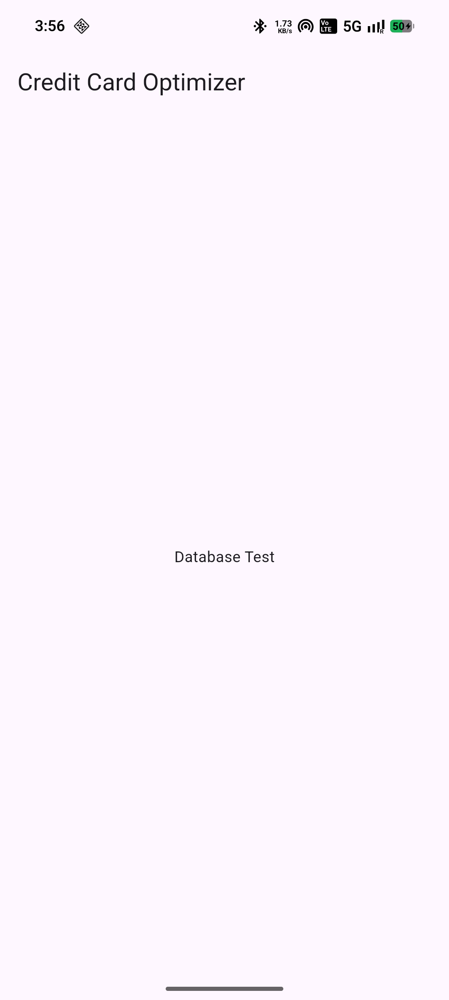

# Credit Card Optimizer

**Credit Card Optimizer** is a Flutter app that helps you organize multiple credit cards and keep track of important billing dates, payment deadlines, and interest-free periods.

The app calculates the card with the longest interest-free period from the current date and displays it as a recommendation. It also reminds you about upcoming statements and payments, so you can manage your cards from one place.

## Preview



## Features

- Add, edit, and delete credit cards
- Store card name, bank, network, color, and last four digits
- Track billing and payment due days
- View the next upcoming statement date
- See upcoming card payments in an organized list
- Mark payments as paid or unpaid
- Rank cards by their available interest-free period
- Receive payment reminders 5, 3, 1, and 0 days before the due date
- Keep card and payment data locally on the device

## How to Use

### Add a card

1. Open the app.
2. Tap the **+** button on the home screen.
3. Enter the card name, such as **Shopping Card**.
4. Select the bank, card network, and card color.
5. Enter the last four digits of the card.
6. Select the **Billing Day** and **Payment Due Day**.
7. Tap **Save Card**.

The billing day is usually printed as the statement generation date. The due day is the date by which the payment must be completed.

### Manage cards

- Swipe the card carousel to browse saved cards.
- Tap a card to update its details.
- Use the delete option on a card to remove it.

### Track payments

- Review upcoming payments in the payment carousel.
- Tap **Mark as Paid** after completing a payment.
- Tap the paid-status control again to mark the payment as unpaid.

### Payment reminders

Allow notifications when the app is opened for the first time. Credit Card Optimizer checks scheduled payment reminders and may notify you:

- 5 days before the due date
- 3 days before the due date
- 1 day before the due date
- On the due date

## Data Storage and Privacy

Card and payment records are stored locally using SQLite through `sqflite`. The app does not connect to a bank or card provider and does not collect card numbers, PINs, CVVs, or account passwords.

> **Recommended:** Enter only the card name and last four digits. Never store sensitive authentication details in the app.

## Tech Stack

- Flutter
- Dart
- SQLite with `sqflite`
- WorkManager for periodic background checks
- Flutter Local Notifications
- Smooth Page Indicator
- Intl

## Getting Started

### Prerequisites

- Flutter SDK 3.12 or later
- Dart SDK 3.12 or later
- Android Studio or VS Code
- An Android device or emulator

Verify your Flutter installation:

```bash
flutter doctor
```

### Run the app

From the project directory:

```bash
flutter pub get
flutter run
```

To run on a specific Android device or emulator:

```bash
flutter devices
flutter run -d <device-id>
```

## Build an APK

```bash
flutter build apk
```

The generated APK is located at:

```text
build/app/outputs/flutter-apk/app-release.apk
```

## Project Structure

```text
lib/
├── background/       # Background WorkManager callback
├── database/         # SQLite database operations
├── models/           # Card, payment, and dashboard models
├── screens/          # Home and card form screens
├── services/         # Recommendations, reminders, and notifications
└── widgets/          # Reusable UI components
```

## Limitations

- Billing dates and due dates are calculated from the day values you provide.
- Interest-free calculations are estimates and may differ from your card issuer's policy.
- Exact background notification behavior can vary by Android version and manufacturer settings.
- The app is a personal planning tool and should not replace advice from your card issuer or bank.
